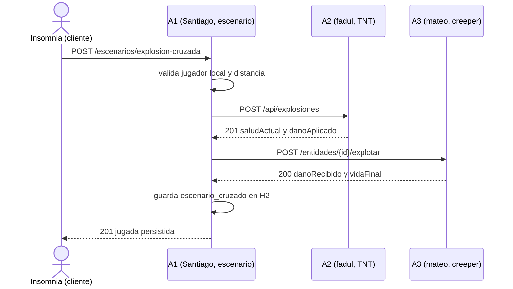
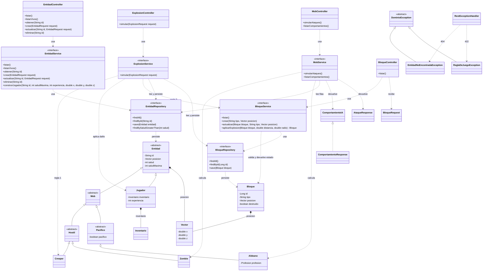

# sb-taller-git-2026

Servicio Spring Boot (Java 21, Maven) para el dominio de Minecraft. Implementa
el CRUD REST de entidades, la persistencia en H2 con Spring Data JPA, una
simulación de explosiones con dos reglas de negocio, una capa service que valida
y lanza excepciones, y un handler HTTP por tipo de error. En POO-09 agrega un
escenario cruzado que consulta las APIs de A2 y A3 y persiste la jugada aceptada
en H2.

## Arranque

```bash
./mvnw spring-boot:run
```

El servicio queda en `http://localhost:8080`. Para compilar y correr las
pruebas:

```bash
./mvnw -q compile
./mvnw test
```

La consola de H2 está disponible en `http://localhost:8080/h2-console` con:

| Dato | Valor |
| --- | --- |
| JDBC URL | `jdbc:h2:file:./data/entidades` |
| Usuario | `sa` |
| Password | vacío |

El archivo de la base se crea en `data/entidades.mv.db` y está ignorado por
Git. Si se detiene la aplicación y se borra ese archivo, la próxima ejecución
recrea el esquema vacío.

## Propiedades de H2

| Propiedad | Para qué sirve |
| --- | --- |
| `spring.application.name=sb-taller-git-2026` | Nombre de la aplicación en logs y actuator. |
| `spring.datasource.url=jdbc:h2:file:./data/entidades` | H2 en modo archivo, dentro del proyecto. |
| `spring.datasource.username=sa` | Usuario de desarrollo de H2. |
| `spring.datasource.password=` | Password vacío, solo para desarrollo local. |
| `spring.jpa.hibernate.ddl-auto=update` | Hibernate crea o actualiza las tablas al arrancar. |
| `spring.jpa.open-in-view=false` | Evita que la sesión JPA quede abierta durante la serialización HTTP. |
| `spring.h2.console.enabled=true` | Habilita la consola web de H2 en desarrollo. |
| `api.restful-api.base-url=https://api.restful-api.dev` | Base de la API REST externa consultada con WebClient. |
| `api.a2.base-url=http://25.30.124.10:8080` | Base de la API de A2 (fadul), configurada para el cliente WebClient. |
| `api.a3.base-url=http://25.28.15.25:8080` | Base de la API de A3 (mateo), configurada para el cliente WebClient. |

## Modelo persistido

Las tres clases concretas que se persisten son:

- `Jugador`: entidad que recibe daño en la simulación.
- `Creeper`: hostil que origina la explosión.
- `Bloque`: objeto del mundo que puede quedar destruido.

`Entidad` es la clase base abstracta de la familia y `Mob`/`Hostil` son clases
intermedias. `Jugador` y `Creeper` son dos especializaciones independientes de
`Entidad`; `Creeper` llega por `Mob -> Hostil` y `Jugador` hereda directo. La
jerarquía se conserva como modelo de estado: las decisiones de ataque,
comportamiento y reglas de juego viven en la capa service.

### Herencia y discriminador

Se eligió `InheritanceType.SINGLE_TABLE`:

- `Entidad` es una `@Entity` abstracta.
- `Mob` y `Hostil` son `@MappedSuperclass`.
- `Jugador` y `Creeper` son `@Entity` con `@DiscriminatorValue`.
- La tabla `entidades` tiene una columna `tipo` que distingue `jugador` de
  `creeper`.

La elección evita joins y deja una sola tabla para consultar la familia. Como
contrapartida, las columnas propias de una hija quedan nulas en las filas de la
otra; por eso `experiencia` es opcional a nivel de tabla y solo se usa en
`Jugador`.

`Vector` es `@Embeddable` y se guarda en las columnas `posicion_x`,
`posicion_y`, `posicion_z` de `Entidad`. `Bloque` usa una tabla separada,
`bloques`, con `id` autogenerado por la base, `tipo`, `destruido` y las
coordenadas `x`, `y`, `z`.

JPA necesita un constructor sin argumentos. En todas las entidades ese
constructor es `protected`: el marco puede instanciarlas, pero el resto del
código no puede crear objetos incompletos. Los constructores públicos solo
inicializan estado; los service validan antes de llamarlos.

### Identidad

La clave es `id` (`String`). El JSON de creación puede traerlo o omitirlo:

- Si lo trae, se usa como clave natural; es útil para probar con ids legibles
  como `steve` o `creeper-poo08`.
- Si lo omite, el servicio genera un `UUID` antes de guardar.

En los dos casos la URL usa el mismo `id` que quedó persistido. El id no es un
índice de una lista del controller.

### Discriminación del subtipo en JSON

El request y el response usan DTOs (`EntidadRequest` y `EntidadResponse`) con
un campo explícito `tipo` (`jugador` o `creeper`). No se usaron anotaciones
polimórficas de Jackson sobre las entidades.

Esa elección mantiene a Jackson fuera de la construcción del dominio: el
service valida los datos y llama al constructor correspondiente. Si
Jackson instanciara las entidades directamente, necesitaría setters o
constructores vacíos públicos y sería mucho más fácil dejar un objeto en un
estado imposible. El DTO también desacopla el contrato HTTP de las columnas
internas de JPA.

## Sobrecarga y sobrescritura

### Sobrecarga

La sobrecarga aparece cuando dos métodos de la misma clase tienen el mismo
nombre y distinta lista de parámetros. Se resuelve en compilación según los
argumentos de la llamada.

- `Bloque(String)` y `Bloque(String, Vector)`: la misma construcción con y sin
  posición explícita; el service siempre pasa una posición validada.
- `Jugador` tiene cuatro constructores: `Jugador(String)`,
  `Jugador(String, int)`, `Jugador(String, int, int)` y
  `Jugador(String, int, int, Vector)`. Los tres primeros delegan directamente en
  el completo y dejan el objeto en un estado legal.
- `Vector()` y `Vector(double, double, double)` son dos constructores con
  distinta lista de parámetros.

### Sobrescritura

La sobrescritura aparece cuando una clase redefine un método con la misma
firma que el padre. Después de esta corrección el dominio no tiene métodos de
negocio sobrescritos: las clases hijas solo heredan estado. La única
sobrescritura presente es `Vector.toString()`, que cambia la representación
textual heredada de `Object`.

`Mob` y `Hostil` conservan la relación de herencia y los constructores llaman a
`super` cuando corresponde. Las decisiones que antes estaban en métodos
sobrescritos ahora están en `MobServiceImpl` y `ExplosionServiceImpl`, donde se
resuelven según el tipo concreto con `instanceof`.

La diferencia práctica sigue siendo la firma y el momento de resolución: la
sobrecarga repite el nombre en la misma clase con parámetros distintos y se
elige al compilar; la sobrescritura repite la firma completa y se elige al
ejecutar mediante polimorfismo.

## Repositorios

- `EntidadRepository extends JpaRepository<Entidad, String>`: CRUD de la familia
  y la consulta derivada `findBySaludGreaterThan(int)`, usada por
  `GET /entidades/vivos`.
- `BloqueRepository extends JpaRepository<Bloque, Long>`: persistencia de los
  bloques de la simulación.
- `EscenarioCruzadoRepository extends JpaRepository<EscenarioCruzado, Long>`:
  jugadas cruzadas aceptadas por A2 y A3 en POO-09.

Los mensajes de consulta se declaran en la interfaz; Spring Data genera la
implementación. El controller depende de `EntidadService`, el service depende
de `EntidadRepository`, y ninguno implementa a mano el acceso a datos.

## API REST

| Método | URL | Uso | Éxito |
| --- | --- | --- | --- |
| `GET` | `/` | Confirmar que el servicio está disponible. | `200` |
| `GET` | `/jugador` | Construir un jugador con parámetros de consulta (POO-06). | `200` o `400` |
| `GET` | `/entidades` | Listar lo persistido. | `200` |
| `GET` | `/entidades/{id}` | Buscar una entidad. | `200` o `404` |
| `GET` | `/entidades/vivos` | Listar entidades con salud mayor que 0. | `200` |
| `POST` | `/entidades` | Crear jugador o creeper. | `201` |
| `PUT` | `/entidades/{id}` | Reemplazar el recurso completo. | `200` |
| `DELETE` | `/entidades/{id}` | Borrar una entidad. | `204` |
| `POST` | `/simulacion/explosiones` | Ejecutar sobre entidades persistidas y guardar el resultado. | `200` |
| `POST` | `/bloques` | Crear un bloque persistido para referenciarlo en la simulación. | `201` |
| `GET` | `/bloques` | Ver los bloques persistidos. | `200` |
| `GET` | `/mobs/ataque` | Calcular ataques con `Zombie` y `Aldeano` desde el service. | `200` |
| `GET` | `/mobs/comportamiento` | Comportamientos de entidades persistidas leídas de H2, expuestos por `ComportamientoIA`. | `200` |
| `GET` | `/objetos-externos` | Consultar la API REST externa con WebClient. | `200` |
| `POST` | `/escenarios/explosion-cruzada` | Validar TNT en A2 y creeper en A3; guarda la jugada si ambos aceptan. | `201`, `422` o `502` |
| `GET` | `/escenarios/explosion-cruzada` | Listar jugadas cruzadas persistidas. | `200` |
| `GET` | `/escenarios/explosion-cruzada/{id}` | Leer una jugada cruzada persistida. | `200` o `404` |
| `GET` | `/v3/api-docs` | Especificación OpenAPI generada por springdoc. | `200` |
| `GET` | `/swagger-ui.html` | Interfaz web de Swagger. | `200` |

### Consulta a la API externa

`GET /objetos-externos` usa `WebClient` y la propiedad
`api.restful-api.base-url=https://api.restful-api.dev` para consultar
`/objects`. La respuesta es una lista de `ObjetoExternoResponse`; si la API
externa falla, el error se propaga al cliente HTTP.

### Documentación OpenAPI

springdoc publica `/v3/api-docs` y `/swagger-ui.html`. Los controladores y DTOs
llevan anotaciones `@Tag`, `@Operation` y `@Schema`, por lo que la documentación
de la API se genera desde el código.

Ejemplo de creación de un jugador:

```json
{
  "tipo": "jugador",
  "id": "steve",
  "salud": 20,
  "saludMaxima": 20,
  "experiencia": 7,
  "x": 3,
  "y": 0,
  "z": 0
}
```

Ejemplo de creación de un creeper:

```json
{
  "tipo": "creeper",
  "id": "creeper-poo08",
  "salud": 20,
  "saludMaxima": 20,
  "x": 0,
  "y": 0,
  "z": 0
}
```

## POO-09 — APIs cruzadas

**Situación de POO-08.** POO-08 quedó con puntaje completo (24/24). Sus cuatro
observaciones ya estaban cerradas antes de POO-09; este repo conserva los
commits que las cerraron. No hay un documento separado de corrección: cada
observación queda identificada en la tabla siguiente con su commit. No se vuelve
a aplicar la rúbrica de 24.

| Observación cerrada | Cómo se cerró | Commit |
| --- | --- | --- |
| Las reglas estaban en el dominio | Las dos reglas se centralizaron en la capa service: daño decreciente en `ExplosionServiceImpl.danioDeExplosion` y destrucción de bloques en `BloqueServiceImpl.aplicarExplosion`. Las clases del dominio quedaron como estado. | `e233fe0` |
| La simulación armaba entidades desde el cuerpo de la solicitud | Ahora lee creeper, jugadores y bloques desde H2 por id, valida el tipo concreto, guarda la salud resultante y el estado `destruido`, y rechaza ids repetidos o ausentes. | `e233fe0` |
| `ComportamientoIA` estaba como responsabilidad del dominio | La interfaz pasó al service como contrato de salida; `MobServiceImpl.listarComportamientos()` lee H2, ordena por id y calcula la descripción según el tipo. | `e233fe0` |
| Mensajes con tildes y redacción incompleta | Se corrigieron los textos de validación y se completó la documentación de endpoints. | `35374b3`, `bde0b74`, `1853e52` |

### Mapa del grupo (round robin)

| Rol | Alumno | Servicio | URL base | OpenAPI | Commit de la solución | Reglas que publica, en una frase |
| --- | --- | --- | --- | --- | --- | --- |
| A1 | Santiago Baez (`SaDez7`) | `sb-taller-git-2026` (este repo) | `http://25.29.140.0:8080` | `http://25.29.140.0:8080/v3/api-docs` | [`0b244776d8d8c08d7457d59c40f5c09e63c3530a`](https://github.com/SaDez7/sb-taller-git-2026/commit/0b244776d8d8c08d7457d59c40f5c09e63c3530a) | El daño de una explosión decae con la distancia hasta 20 puntos y todo bloque dentro del radio queda destruido. |
| A2 | Lucas Fadul (`LucasFadul`) | `lfadul-tp-lp3-2026` | `http://25.30.124.10:8080` | `http://25.30.124.10:8080/v3/api-docs` | [`a5819ea5dea43054d700ee87be5d502f21336748`](https://github.com/LucasFadul/lfadul-tp-lp3-2026/commit/a5819ea5dea43054d700ee87be5d502f21336748) | Una TNT detona una sola vez y aplica hasta 8 puntos de daño a entidades dentro de 4 bloques. |
| A3 | Mateo Ríos (`MatRF04`) | `mr-taller-git-2026` | `http://25.28.15.25:8080` | `http://25.28.15.25:8080/v3/api-docs` | [`a80b0ea2341d810028544f04371a45caf752634f`](https://github.com/MatRF04/mr-taller-git-2026/commit/a80b0ea2341d810028544f04371a45caf752634f) | Un creeper vivo explota una sola vez y daña hasta 10 puntos a objetivos a 3 bloques o menos. |

A1 es el servicio propio y el único que orquesta el escenario; A2 y A3 son los
dos consumos ajenos. Las reglas se tomaron leyendo los documentos OpenAPI de los
compañeros, sin clonar su código fuente ni copiar sus clases. Swagger de A1 está
en `http://25.29.140.0:8080/swagger-ui.html`.

Para arrancar A1 desde el commit entregado:

```bash
git clone https://github.com/SaDez7/sb-taller-git-2026.git
cd sb-taller-git-2026
./mvnw spring-boot:run
```

Para arrancar A2 y A3 desde los commits entregados por sus dueños, en carpetas
separadas:

```bash
# A2: Lucas Fadul
git clone https://github.com/LucasFadul/lfadul-tp-lp3-2026.git
cd lfadul-tp-lp3-2026
git checkout a5819ea5dea43054d700ee87be5d502f21336748
./mvnw spring-boot:run

# A3: Mateo Ríos
git clone https://github.com/MatRF04/mr-taller-git-2026.git
cd mr-taller-git-2026
git checkout a80b0ea2341d810028544f04371a45caf752634f
./mvnw spring-boot:run
```

Estos clones son solo para reproducir la prueba: este repo no incorpora su código,
solo consulta sus OpenAPI con las URLs de la tabla. Después se verifica
`GET /v3/api-docs` en la IP de cada uno. Los tres quedan expuestos en la IP Hamachi
de cada máquina. Si un compañero no responde, A1 devuelve `502 companero_no_disponible`
con el nombre de la API en el campo `api`; en la prueba real A3 devolvió
`Conexión rehusada` una vez, se reintentó con otra TNT y la respuesta quedó
registrada abajo.

### Escenario propio: explosión cruzada

El hecho del juego es una explosión que necesita las dos validaciones ajenas para
ser legal: la TNT de A2 debe poder detonar contra una entidad y el creeper de A3
debe poder explotar contra otro objetivo. A1 además exige que `jugadorId` sea un
jugador vivo persistido en su H2 y que `distanciaA3` esté entre 0 y 3 bloques.

A1 valida primero al jugador local, después llama a A2
(`POST /api/explosiones`) y por último a A3
(`POST /entidades/{id}/explotar`). A2 va primero porque su respuesta entrega
`saludActual` y `danoAplicado`, que se guardan; A3 va después porque entrega
`vidaFinal` y `danoRecibido`. Si A2 rechaza, A3 no se llama. Si A3 rechaza, la
TNT de A2 ya se consumió en el servicio ajeno, pero el H2 de A1 queda igual.



Solicitud de ejemplo (caso feliz):

```json
{
  "jugadorId": "steve",
  "tntId": "t3",
  "objetivoA2Id": "esqueleto1",
  "creeperA3Id": 4,
  "objetivoA3Id": 2,
  "distanciaA3": 2
}
```

Respuesta real (`201`):

```json
{
  "id": 1,
  "jugadorId": "steve",
  "tntId": "t3",
  "objetivoA2Id": "esqueleto1",
  "explosionA2Id": 3,
  "danoA2": 8,
  "saludA2Despues": 12,
  "creeperA3Id": 4,
  "objetivoA3Id": 2,
  "distanciaA3": 2,
  "danoA3": 10,
  "vidaA3Despues": 0
}
```

`GET /escenarios/explosion-cruzada` y `GET /escenarios/explosion-cruzada/1`
devuelven la misma jugada persistida. La tabla H2 `escenarios_cruzados` guarda
`id`, `jugador_id`, `tnt_id`, `objetivo_a2_id`, `explosion_a2_id`, `dano_a2`,
`salud_a2_despues`, `creeper_a3_id`, `objetivo_a3_id`, `distancia_a3`, `dano_a3`
y `vida_a3_despues`. El service es `@Transactional` y guarda recién después de
las dos respuestas aceptadas.

Para repetir la prueba hay que crear otra TNT en A2 con `POST /api/tnts` y elegir
un creeper vivo con `GET /entidades/creepers/listos` de A3: `t3` ya detonó y el
creeper `4` ya explotó. El jugador local `steve` debe existir por
`POST /entidades` en A1.

### Errores de los compañeros

A1 traduce el rechazo ajeno a su propia jerarquía y distingue al responsable en
el campo `api`. Un rechazo de negocio responde `422` con
`tipo: "validacion_companero"`; un problema de red responde `502` con
`tipo: "companero_no_disponible"`.

Rechazo real de A2 al repetir `t3` (`422`):

```json
{
  "tipo": "validacion_companero",
  "mensaje": "La API de A2 rechazó la validación con 409.",
  "api": "A2",
  "statusCompanero": 409,
  "detalle": "{\"error\":\"La TNT ya fue detonada\"}"
}
```

Rechazo real de A3 con TNT `t4` y creeper `4` ya explotado (`422`):

```json
{
  "tipo": "validacion_companero",
  "mensaje": "La API de A3 rechazó la validación con 409.",
  "api": "A3",
  "statusCompanero": 409,
  "detalle": "{\"error\":\"El creeper ya explotó\"}"
}
```

Después de ambos rechazos, `GET /escenarios/explosion-cruzada` sigue mostrando
solo la jugada `id: 1`: la base de A1 no creció. `CompaneroWebClientImpl` usa dos
`WebClient` configurados con `api.a2.base-url` y `api.a3.base-url`, con timeout
de 10 segundos; los DTOs de pedido y respuesta se armaron desde los OpenAPI
ajenos.

## Las dos reglas de negocio

Las dos reglas viven en la capa service y las dispara el controller de
simulación a través de `ExplosionService`. Las clases del dominio solo guardan
estado; no validan, no lanzan excepciones y no calculan reglas de juego.

1. **El daño de la explosión decae con la distancia.** En
   `ExplosionServiceImpl.danioDeExplosion(distancia, radio)`, un objetivo dentro
   del radio recibe hasta 20 puntos de daño; la fórmula es
   `max(1, round(20 * (1 - distancia / radio)))`. Fuera del radio el daño es 0.
2. **Todo bloque alcanzado por el radio queda destruido.** En
   `BloqueServiceImpl.aplicarExplosion(bloque, distancia, radio)`, si la
   distancia es menor o igual que el radio, el bloque se marca como `destruido`.

La simulación carga el creeper, los jugadores y los bloques desde H2 usando
solo los ids del cuerpo; no crea entidades nuevas ni reescribe su estado con
datos del pedido. Si falta algún id, responde `404`. Después de aplicar las
reglas guarda el jugador con su salud actualizada y el bloque con su estado.

Ejemplo de simulación:

```json
{
  "creeperId": "creeper-poo08",
  "radio": 5,
  "jugadores": [
    { "id": "steve" }
  ],
  "bloques": [
    { "id": 1 }
  ]
}
```

El creeper y `steve` deben existir por `POST`/`PUT /entidades`, y el bloque `1`
por `POST /bloques`. La posición y la salud salen de H2: el `origen`, la salud
máxima del creeper y la salud/posición de cada jugador ya no van en el cuerpo de la solicitud.
En este caso `steve` está a distancia 3 de un radio 5, recibe 8 de daño y pasa
de 15 a 7; el bloque a distancia 2 queda destruido. Repetir el pedido parte de 7
y acumula el daño en vez de curarlo. Un `GET /entidades/steve` o `GET /bloques`
posterior muestra el estado guardado.

`Bloque` no expone `setDestruido`. El único camino para marcar un bloque es
`BloqueServiceImpl.aplicarExplosion`, que valida radio y distancia y devuelve una
nueva instancia con el estado calculado.

## Comportamiento en la capa service

`MobService` expone `simularAtaques()` y `listarComportamientos()`. En
`listarComportamientos()` el service ya no arma mobs temporales: lee las filas
de H2 con `EntidadRepository.findAll()`, las ordena por id y devuelve una lista
de `ComportamientoIA`. Cada fila persistida se adapta a un
`ComportamientoResponse`, que implementa esa interfaz; las descripciones se
calculan en `MobServiceImpl` según el tipo concreto (`Jugador`, `Creeper`).
`MobController` consume la interfaz y construye el DTO de respuesta.

Las clases del dominio siguen sin métodos de comportamiento: `Zombie` y
`Aldeano` solo conservan el estado de las familias `Hostil` y `Pacifico`, usadas
por `simularAtaques()`. La lógica que antes estaba en `ComportamientoIA` y
`AtacaJugador` vive en el service, y la interfaz `ComportamientoIA` volvió como
contrato de salida del endpoint, no como responsabilidad de la entidad.

## Excepciones y handlers

La jerarquía es:

- `DominioException`: clase base abstracta, no comprobada, extiende
  `RuntimeException`.
- `EntidadNoEncontradaException`: hija para un id que no existe. Responde
  `404`.
- `ReglaDeJuegoException`: hija para una regla de negocio incumplida. Responde
  `422`.

La jerarquía es no comprobada porque un id inexistente o una regla de juego
rota no se resuelven localmente: son errores de la solicitud que el handler
HTTP traduce. Si fueran comprobadas, cada capa tendría que declarar `throws` y
el controller quedaría acoplado a los detalles del dominio.

El JSON de error siempre lleva `tipo` y `mensaje`, de modo que las hermanas se
distinguen por esos campos, no solo por el código HTTP:

```json
{
  "tipo": "entidad_no_encontrada",
  "mensaje": "No existe una entidad con id no-existe."
}
```

```json
{
  "tipo": "regla_de_juego",
  "mensaje": "La salud no puede superar la salud máxima."
}
```

`HttpMessageNotReadableException` responde `400` con `tipo: "json_invalido"`.
`IllegalArgumentException` responde `400` con `tipo: "argumento_invalido"`.
Se eligió `422` para las reglas de juego porque el JSON está bien formado pero
el contenido viola una regla de negocio validada en el service; el `400` queda
para cuerpos malformados o argumentos inválidos.

## Diagrama de clases



En el diagrama se distinguen:

- **Herencia:** líneas con `<|--` entre `Entidad`, `Mob`, `Hostil`, `Pacifico`,
  `Jugador`, `Creeper`, `Zombie` y `Aldeano`.
- **Estado del dominio:** `Entidad`, `Mob`, `Hostil`, `Pacifico`, `Jugador`,
  `Creeper`, `Zombie`, `Aldeano` y `Bloque` solo guardan datos.
- **Uso del repositorio:** dependencias con `..>` desde el service/controller
  hacia `EntidadRepository` y `BloqueRepository`.
- **Jerarquía de excepciones:** `DominioException` como base y sus dos hijas,
  más las dependencias del handler.

## Colección Insomnia

El archivo versionado es `insomnia/sb-taller-git-2026.json`.

Para importarlo:

1. Abrir Insomnia.
2. Elegir `Import` y luego `From File`.
3. Seleccionar `insomnia/sb-taller-git-2026.json`.
4. Verificar que el entorno incluido se llame `Local` y que `base_url` sea
   `http://localhost:8080` (o `http://25.29.140.0:8080` si se prueba por
   Hamachi), `a2_base_url` `http://25.30.124.10:8080` y `a3_base_url`
   `http://25.28.15.25:8080`.

Orden recomendado:

1. `00 - Servicio vivo`.
2. `01 - Crear jugador` y `02 - Crear creeper`.
3. `03` a `08` para listar, consultar, actualizar y borrar.
4. `09 - Crear bloque`.
5. `10 - Simular explosión`.
6. `11 - Ver jugador después de simular` y `12 - Ver bloques persistidos`.
7. `13 - Comportamiento`.
8. `14 - Error ReglaDeJuego (422)`, `15 - Error EntidadNoEncontrada (404)` y
   `16 - Error JSON inválido (400)`.
9. `17 - OpenAPI propia`, `18 - OpenAPI A2` y `19 - OpenAPI A3` para confirmar
   que los tres documentos están disponibles.
10. `20 - Crear TNT A2 (feliz)` y `21 - Escenario feliz`.
11. `22 - Ver escenarios guardados`: debe aparecer la jugada recién persistida.
12. `23 - Rechazo A2`, creado con la misma TNT ya detonada.
13. `24 - Crear TNT A2 (rechazo A3)` y `25 - Rechazo A3`, con el creeper ya
    explotado.
14. `26 - Ver escenarios tras rechazos`: la lista queda igual que en el paso 11.

Antes de repetir, cambiar `tnt_feliz_id` y `tnt_rechazo_a3_id` por ids nuevos de
A2; los valores iniciales son `t5` y `t6`. Elegir `objetivo_a2_id`,
`creeper_a3_id`, `objetivo_a3_id` y `distancia_a3` con `GET /api/entidades` de A2
y `GET /entidades/creepers/listos` / `GET /entidades` de A3; los valores
sugeridos son `jugador1`, `5`, `3` y `2`.

Si se vuelve a ejecutar la colección sobre la misma base, el `POST` de `steve`
puede fallar por id duplicado. Para reiniciar: detener la aplicación, borrar
`data/entidades.mv.db` y arrancar de nuevo. También se pueden borrar
`steve`/`creeper-poo08` con `DELETE` antes de repetir.

La prueba de que un `POST` ilegal no ensucia la base es la solicitud
`14 - Error ReglaDeJuego (422)`: responde error y la solicitud `03 - Listar
entidades` sigue mostrando las mismas filas, sin `ilegal`.

## Preguntas de «Qué hay que pensar»

**Recurso y verbo.** El sustantivo es `entidades`; las URL nombran el recurso y
el verbo HTTP dice la operación: `GET` lee, `POST` crea, `PUT` actualiza y
`DELETE` borra. La simulación es un recurso propio, `explosiones`, bajo
`/simulacion`.

**Identidad.** La clave es `id`. El JSON puede traerlo o no; si no viene, el
servicio genera un UUID. La URL usa el id persistido, no una posición de lista.

**Herencia y tablas.** Se usó una sola tabla con discriminador `tipo` para la
familia de `Entidad`, y una tabla aparte para `Bloque`. El subtipo se
discrimina en el JSON con el campo `tipo` del DTO.

**Interfaz y repositorio.** El controller depende de `EntidadService`, que
depende de `EntidadRepository`, una interfaz. Spring Data genera la
implementación. El controller trabaja contra el contrato y no contra una
implementación concreta: puede cambiar el acceso a datos sin tocar la capa HTTP.

**Comportamiento en el service.** `GET /mobs/ataque` pasa por `MobService`, que
usa el estado de `Zombie` (rama `Hostil`) y `Aldeano` (rama `Pacifico`) para
calcular el daño. `GET /mobs/comportamiento` lee entidades persistidas de H2,
las expone como `ComportamientoIA` desde el service y el controller las adapta
a `ComportamientoResponse`; las entidades del dominio no deciden nada.

**Ocultamiento y validación.** Las reglas numéricas viven en
`ExplosionServiceImpl` y `BloqueServiceImpl`, no en el controller ni en el
dominio. JPA usa acceso por campo y los service validan salud, salud máxima,
posición, tipo, radio y distancia antes de mutar el estado con los setters. El
request `14` de Insomnia muestra que un `POST` ilegal responde `422` y la base
queda igual porque la validación ocurre antes de guardar y la transacción hace
rollback ante cualquier error.

**PUT y PATCH.** Se implementó `PUT`, que reemplaza el recurso completo. Los
campos `salud` y `saludMaxima` son obligatorios; `experiencia` vale 0 si se
omite y las coordenadas valen 0 si se omiten. No se implementó `PATCH`.

**DELETE.** Borra físicamente la fila. Antes de borrar se busca la entidad; si
no existe, `EntidadServiceImpl` lanza `EntidadNoEncontradaException` y el handler
responde `404`. El verbo HTTP no ejecuta una regla de juego adicional.

**Dos reglas.** La primera es el daño decreciente de la explosión; la segunda
es la destrucción de bloques dentro del radio. El recurso HTTP es
`POST /simulacion/explosiones`. Un `GET /entidades/{id}` y un `GET /bloques`
posteriores muestran el estado ya persistido.

**Excepciones.** `EntidadNoEncontradaException` nombra el recurso ausente y
`ReglaDeJuegoException` nombra una regla incumplida. Son tipos distintos: la
primera responde `404` y la segunda `422`. El JSON de error lleva `tipo` y
`mensaje`. Se usan excepciones no comprobadas porque el handler centraliza la
traducción a HTTP y las capas no quedan obligadas a declarar `throws`.

## Bitácora

El detalle de asistentes, modelos y prompts está en `BITACORA.md`.
